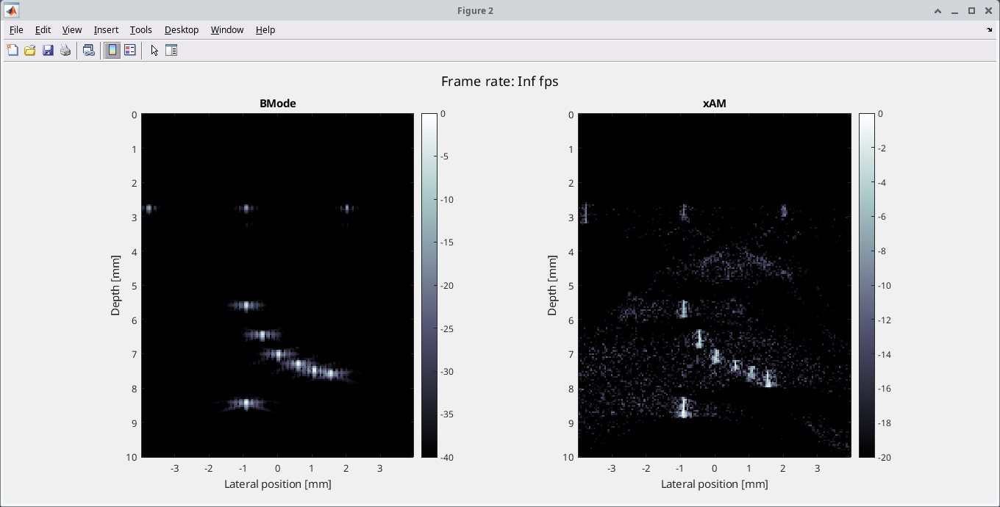

# xAM imaging

MATLAB sequence for **cross-amplitude modulation (xAM)** ultrasound imaging on
Verasonics Vantage and Vantage NXT research systems, for artifact-free
detection of gas vesicles (GVs).

xAM transmits cross-propagating plane waves from the two halves of an aperture.
The echoes of both halves firing together (X), minus the echoes of each half
firing on its own (L and R), cancel for linear scatterers and keep the
nonlinear signal from buckling GVs. Because the two plane waves only overlap along the bisector
of the aperture, nonlinear *propagation* artifacts are suppressed as well. See:

> Maresca et al., "Nonlinear Ultrasound Imaging of Nanoscale Acoustic
> Biomolecules", *Phys. Rev. X* **8**, 041002 (2018).
> [doi:10.1103/PhysRevX.8.041002](https://doi.org/10.1103/PhysRevX.8.041002)

## Features

- Live B-mode and xAM imaging side by side, with adjustable dynamic range and
  persistence.
- Ray-by-ray xAM with adaptive xWave angles and half-pitch scanning.
- **Save Data**: snapshot of the frozen sequence, as images or raw RF.
- **Record**: continuous recording of a set number of frames, as images or raw
  RF, without dropping frames.
- **Voltage sweep**: mean xAM signal against transmit voltage, in two passes, to
  find the best imaging voltage.
- Runs on Vantage NXT 2.2 / 2.3 (tested with 2.3.2-p2) and Vantage 4.x (the
  original target), on hardware or in simulation mode.

## Documentation

| Page | Contents |
| --- | --- |
| [Installation](installation.md) | Software requirements, licences, folder layout |
| [Quick start](quick-start.md) | Running the sequence for the first time |
| [GUI controls](gui-controls.md) | What every button and slider does |
| [Parameters](parameters.md) | All settings in `xAM_imaging.m` |
| [How it works](how-it-works.md) | Transmit scheme, sequence, data layout, beamforming |
| [Saving data](saving-data.md) | Snapshots, recordings, file formats, loading data |
| [Voltage sweep](voltage-sweep.md) | Finding the best imaging voltage for GVs |
| [Performance](performance.md) | Frame-rate budget and measured save/reconstruction times |
| [Simulation mode](simulation.md) | Testing without hardware, and what to expect |
| [Troubleshooting](troubleshooting.md) | Known errors and their fixes |
| [Code reference](code-reference.md) | What each function does |

## Authors

- Rick Waasdorp (r.waasdorp@tudelft.nl)
- David Maresca (d.maresca@tudelft.nl)

Licensed under the MIT licence.
