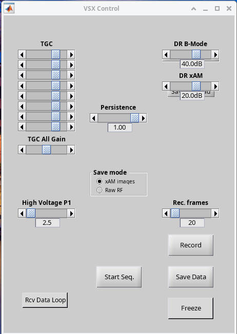

# Quick start

## 1. Review the parameters

Open `xAM_imaging.m` and check the basic parameters at the top:

```matlab
Trans.name = 'L22-14vX';        % tested transducers are L22-14vX / L11-5v
P.image_start_depth_mm = 0;     % start depth [mm]
P.image_end_depth_mm = 10;      % end depth [mm]
P.xwave_angles = 17;            % xWave angle in degrees
P.speed_of_sound = 1480;        % agar/water 1480 m/s, tissue 1540 m/s
P.image_voltage = 2.5;          % keep low to avoid collapsing GVs
P.fps = 2;                      % frame rate [Hz]
P.save_path = fullfile(repo_root, 'data');  % snapshots
P.record_path = P.save_path;    % recordings: put this on a fast (NVMe) drive
```

All parameters are described in [Parameters](parameters.md).

## 2. Point the script to the Verasonics software

VSX only runs with the root of the Verasonics software folder as the current
folder. The script changes to it just before setting up the sequence; set the
path in this line (after the `addpath` block):

```matlab
cd("/path/to/VantageNXT-2.3.2-p2");
```

## 3. Activate and run

From a terminal, the quickest way is the launcher script in the repository:

```bash
./run_xam.sh                    # hardware
./run_xam.sh --sim              # simulation, no hardware needed
./run_xam.sh --help             # all options (voltage sweep, save mode, ...)
```

It starts MATLAB R2024a in the terminal, activates the Verasonics software and
runs the script. Set `MATLAB=...` or `VANTAGE_ROOT=...` if they are not in the
default locations. To run it from MATLAB instead:

Once per MATLAB session, activate the Verasonics software from its root folder:

```matlab
cd /path/to/VantageNXT-2.3.2-p2
activate
```

Then run `xAM_imaging.m` in any way (editor *Run*, `run(...)`, or by name if
it is on the path). The script builds the sequence, saves it to
`MatFiles/xAM_imaging.mat` in the repository, and starts VSX.

## 4. Start imaging

The VSX control panel and the image window open, but the hardware stays
paused. When the transducer is in contact with the sample (water, phantom,
...), press **Start Seq.** to start acquiring.



The image window shows the B-mode image (left) and the xAM image (right). The
dashed white line marks the maximum depth at which the two plane waves still
cross for each ray; below it, xAM is not reliable.

## 5. Find the right voltage

Start at a low **High Voltage** and increase it slowly until nonlinear signal
appears in the xAM image. Too low and the GVs do not buckle (no xAM signal);
too high and they collapse (the signal disappears permanently).

## 6. Save data

- **Snapshot**: press **Freeze**, then **Save Data**.
- **Recording**: while running, choose the number of frames with **Rec.
  frames** and press **Record**.

Choose images or raw RF with **Save mode** first. See
[Saving data](saving-data.md) for what is saved and how to load it.

## 7. Stop

Close the VSX control panel. The hardware stops and VSX returns to the MATLAB
prompt.
