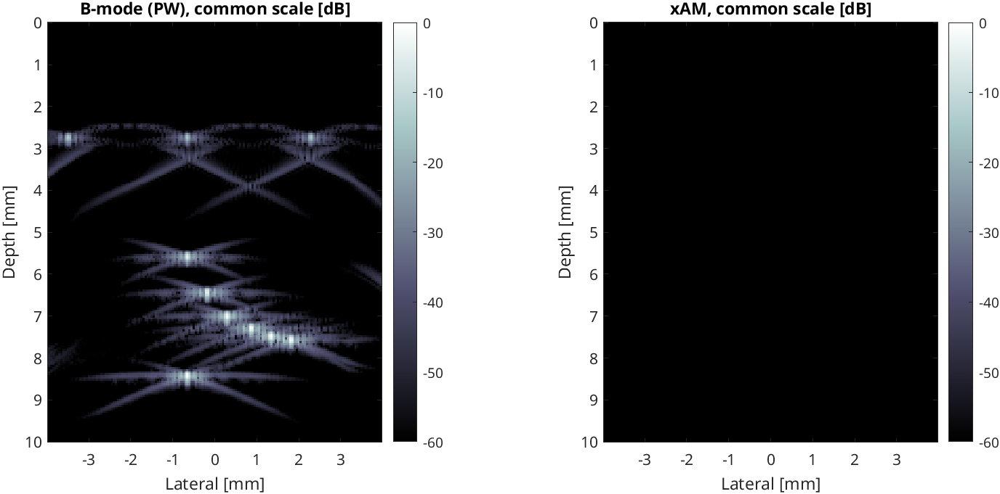

# Simulation mode

The Verasonics software can simulate acquisitions without hardware. This is
useful for testing changes to the sequence, the GUI and data saving.

## Running a simulation

```bash
./run_xam.sh --sim                       # with the GPU beamformer
./run_xam.sh --sim --cpu-beamformer      # without a GPU
```

`--sim` sets `Resource.Parameters.simulateMode = 1` (it is 0, hardware, by
default). The simulator uses the point targets from `pt1` (`Media`), moved
slightly between frames by `movePoints`.

Simulation needs a Verasonics licence that includes the simulator and is
issued for this computer (see [Installation](installation.md#verasonics-licence)).

## What to expect



- **B-mode** shows the point targets of `pt1` between about 2.8 and 8.5 mm depth.
- **xAM** is empty: about 80 dB below the B-mode peak. The simulator
  is linear, so `X − L − R` cancels. This is a good check that the X, L and R
  transmits are consistent.
- In the live display the xAM panel still shows the targets, because each
  panel is normalised to its own maximum.
- **Time tags** are zero, so the frame rate in the image title shows `NaN` or
  `Inf`, and recordings report timing from the host clock.

## Testing without the beamformer

With `--cpu-beamformer` (or `P.use_cpu_beamformer = true`), the MATLAB
reference beamformer `xw_beamform_cpu` is used. It needs no GPU or compiled
code, and gives the same images as `xw_beamform_gpu` (to within 1e-7), but
takes about 200 ms per image, so the frame rate drops to about 1-1.5 Hz. All
controls, recording and the voltage sweep work.

In simulation, the transmit voltage does not change the simulated echoes, so a
voltage sweep gives flat curves (see [Voltage sweep](voltage-sweep.md)).
