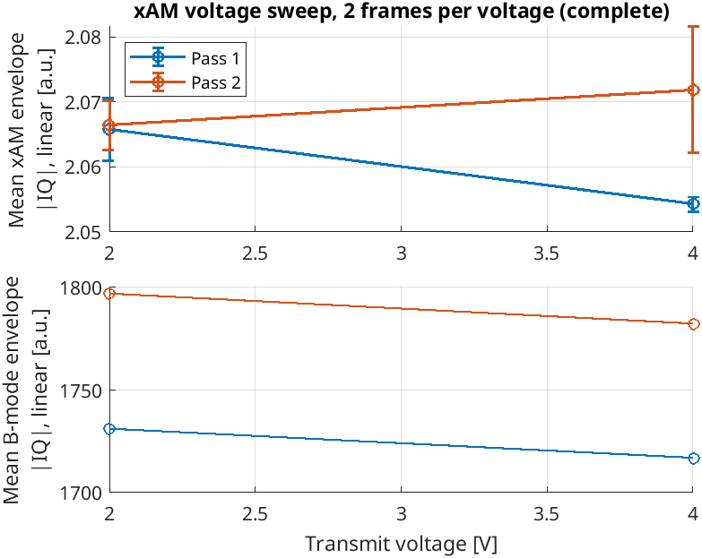

# Voltage sweep

GVs only give xAM signal above their buckling pressure, and collapse (and stop
giving signal) above a higher pressure. A voltage sweep measures the mean xAM
envelope over a range of transmit voltages, twice, to find a voltage that gives
strong xAM signal without collapsing the GVs.

## Running a sweep

```bash
./run_xam.sh --sweep 1.6:0.4:6
```

| Option | Description |
| --- | --- |
| `--sweep VOLTAGES` | Voltages to sweep [V]: `start:step:stop` (e.g. `1.6:0.4:6`), `start:stop` (1 V steps) or a list (`2,3,5`). Adds a **Voltage sweep** button. |
| `--sweep-frames N` | Frames recorded and measured per voltage (default 5). |
| `--sweep-save images` / `--sweep-save rf` | What is saved for each voltage: beamformed images (default, ~0.6 MB per frame) or raw RF (~190 MB per frame). Independent of the **Save mode** switch. |
| `--sim`, `--cpu-beamformer` | Simulation mode, and the slow MATLAB beamformer (for testing without hardware or a GPU). |

Then, in VSX:

1. Press **Start Seq.** and position the probe at the normal (low) imaging
   voltage, so the GVs are not collapsed before the sweep.
2. Press **Voltage sweep**. The image title shows the pass, voltage and phase
   (`settle` or `record`).
3. When the sweep is done, the voltage is set back to the value before the
   sweep, and the result plot opens. Press **Voltage sweep** again to stop a sweep
   early; the results so far are saved and plotted.

Voltages above `P.sweep_max_voltage` (25 V by default; the L22-14vX limit
is 30 V) are refused when the script starts.

## What happens per voltage

For each pass (2 by default), going up through the voltages:

1. **Set the voltage** of TPC profile 1, the same way the **High Voltage P1**
   slider does. The slider follows the sweep.
2. **Settle**: discard at least `P.sweep_settle_frames` (2) frames and
   `P.sweep_settle_s` (1 s), or `P.sweep_settle_s_down` (3 s) when the voltage
   goes down, as at the start of pass 2. The change reaches the hardware the
   next time VSX returns to MATLAB, so the frame already being acquired still
   uses the old voltage.
3. **Record and measure** `P.sweep_frames` frames: the frames are saved
   (images by default, or RF with `--sweep-save rf`), and the mean xAM and
   B-mode envelope of each frame is computed over the region where the two
   plane waves cross (above the dashed line).

The envelope is the magnitude of the beamformed IQ data, `abs(BFData.xAM)`,
before log compression (log compression is only used for the display). It is
averaged on a linear scale; persistence is not applied.

### Why the voltage is changed this way

The Vantage has at most four TPC profiles (plus a high-power profile 5). The
BURST scripts switch between fixed profiles with the `setTPCProfile` sequence
command, which gives precise switching within a frame, but only for a few
voltages. A sweep needs more voltages and no precise timing, so it changes the
voltage of profile 1 at runtime (`setTpcProfileHighVoltage`), between frames.
A profile transition takes 0.8 to 8 ms, well within the time between frames.

## Results

Each sweep gets a folder `P.record_path/<yyyymmdd_HHMMSS>_sweep_<mode>/`:

```text
20261013_155112_sweep_images/
├── pass1_02.00V/          one recording per pass and voltage
│   ├── acq_parameters.mat     includes TPC(1).hv for this step
│   ├── recording_info.mat
│   └── frame_00001.mat …      BFData per frame (frame_00001.bin … with --sweep-save rf)
├── pass1_04.00V/
├── …
├── pass2_06.00V/
├── sweep_results.mat
├── sweep_results.png
└── sweep_results.fig
```

Each step folder is a normal recording (see [Saving data](saving-data.md)).
With the default image saving, a sweep of 12 voltages × 2 passes × 5 frames
takes about 100 MB; with `--sweep-save rf` it is about 22 GB.

### sweep_results.mat

| Field | Description |
| --- | --- |
| `status` | `complete`, `stopped by user`, or the error that stopped the sweep |
| `voltages_requested` | Voltages from `--sweep` |
| `hv_set` | Voltage actually set, `[passes × voltages]` |
| `mean_xam`, `std_xam` | Mean xAM envelope (linear \|IQ\| averaged over `roi`), mean and standard deviation over frames, `[passes × voltages]` |
| `mean_bmode` | Mean B-mode envelope, averaged over frames, `[passes × voltages]` |
| `mean_xam_frames`, `mean_bmode_frames` | Per frame, `[passes × voltages × frames]` |
| `roi` | Pixels used for the means, `[depth × rays]` |
| `frames_per_voltage`, `settle_frames`, `settle_s`, `save_mode`, `t_start`, `t_end` | Sweep settings and timing |

### Reading the plot



- **Top: mean xAM envelope against voltage** (linear, before log
  compression), one curve per pass, with the standard
  deviation over frames. In pass 1, xAM rises once the GVs start to buckle.
  If the GVs collapse at a voltage, the signal drops at that voltage and
  above, and stays lower in pass 2.
- **Bottom: mean B-mode envelope** should rise roughly in proportion to the voltage.
  It checks that each voltage was actually applied.

A good imaging voltage gives high xAM in pass 1 and about the same xAM in
pass 2 at that voltage (no collapse).

The example above is from simulation mode: the simulated medium is linear and
does not depend on the transmit voltage, so both curves are flat.
